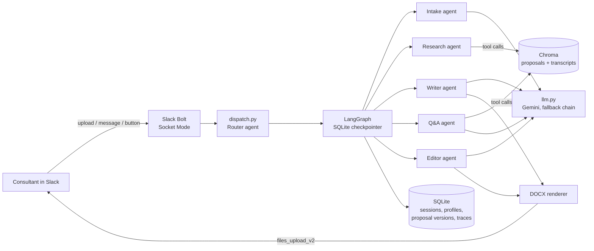
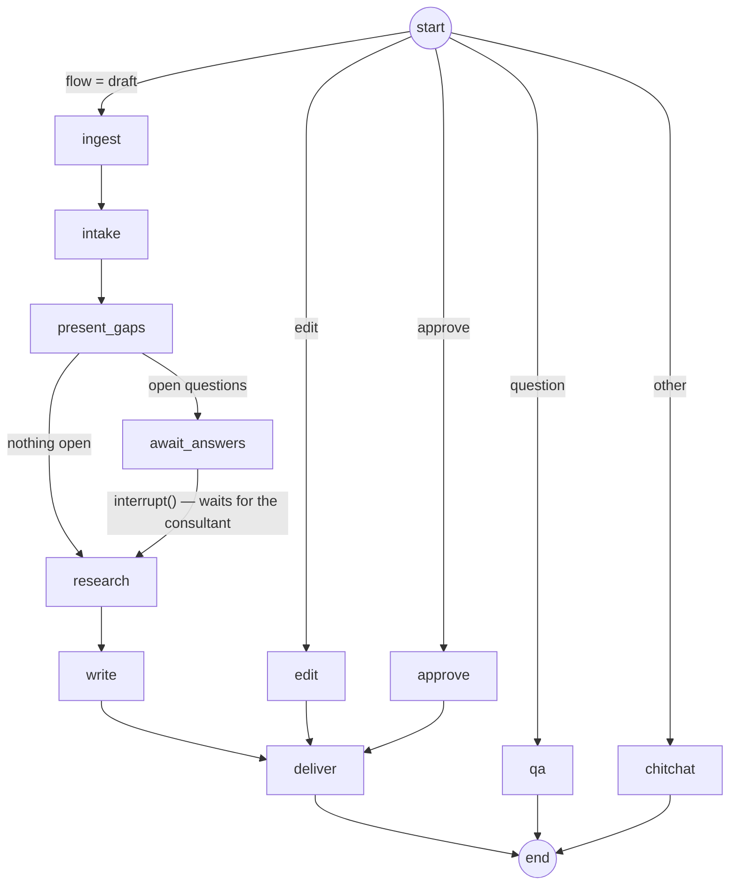

# Proposal Assistant

A Slack bot that turns a client discovery-call transcript into a tailored, formatted proposal (DOCX), using the firm's past proposals as reference. Six agents with one job each are coordinated by **LangGraph**, retrieval runs on a **vector database** with metadata filtering, and every session is **persisted**, so the consultant can come back the next day and continue where they left off.

> Built for the empowrd.ai multi-agent assessment. Architecture decisions, trade-offs and what is unfinished are in **[docs/DECISIONS.md](docs/DECISIONS.md)**.

---

## Table of contents

1. [What it does](#1-what-it-does)
2. [Demo flow in Slack](#2-demo-flow-in-slack)
3. [Architecture](#3-architecture)
4. [The agents](#4-the-agents)
5. [Orchestration with LangGraph](#5-orchestration-with-langgraph)
6. [Retrieval (RAG)](#6-retrieval-rag)
7. [Validation and guardrails](#7-validation-and-guardrails)
8. [State and persistence](#8-state-and-persistence)
9. [LLM layer](#9-llm-layer)
10. [Document generation](#10-document-generation)
11. [Tech stack and why](#11-tech-stack-and-why)
12. [Setup](#12-setup)
13. [Running](#13-running)
14. [Tests](#14-tests)
15. [Project structure](#15-project-structure)
16. [Limitations and next steps](#16-limitations-and-next-steps)

---

## 1. What it does

| Requirement | How it is met | Where |
|---|---|---|
| Accept a transcript upload in Slack | DM or @mention with a `.txt`, `.md` or `.docx` file | [app/slack/handlers.py](app/slack/handlers.py) |
| Extract client info; flag missing or unclear info, never guess | Intake agent returns each field with a status (`present`, `ambiguous`, `conflicting`, `missing`) and exact quotes; code verifies every quote against the transcript | [app/agents/intake.py](app/agents/intake.py) |
| Meaning-based search of past proposals | Gemini embeddings in Chroma, cosine similarity, filtered by industry and section type | [app/rag/store.py](app/rag/store.py) |
| Generate a structured proposal | Writer plans the outline from the closest past proposals, then writes each section | [app/agents/writer.py](app/agents/writer.py) |
| Formatted DOCX delivered in Slack | Deterministic python-docx renderer, uploaded to the thread | [app/docx/render.py](app/docx/render.py) |
| Answer follow-up questions | Q&A agent with tools over the transcript, profile and draft | [app/agents/qa.py](app/agents/qa.py) |
| Change only the relevant section | Editor rewrites only the target sections; the repository copies all others unchanged into the new version | [app/agents/editor.py](app/agents/editor.py), [app/db/repo.py](app/db/repo.py) |
| Human in the loop | Draft pauses for the consultant's answers (LangGraph `interrupt`); Approve button | [app/graph/build.py](app/graph/build.py) |
| Persist state across sessions | SQLite tables + LangGraph SQLite checkpointer + Chroma on disk | [app/db/models.py](app/db/models.py) |

## 2. Demo flow in Slack

1. **Upload** `client_transcript.txt` in a direct message to the bot.
2. The bot replies in a thread: *"Got client_transcript.txt (7 passages indexed). Reading it now…"*
3. **Intake summary**: each field with ✅ / ⚠️ / ❓. For the sample transcript the budget is flagged **conflicting** ($50k from the CEO vs up to $120k from the Operations Manager, with quotes and turn numbers), the timeline **ambiguous** (Q3 target, Q4 fallback) and the shipping software **missing**.
4. The draft **pauses**. The consultant either replies with answers (*"Use $50k as the baseline, $120k as optional scope"*) or clicks **Draft now, mark gaps TBD**.
5. Research, then writing. The **DOCX v1** arrives in the thread with an **Approve** button.
6. *"what did the client say about their deadline?"* returns exact quotes with speakers and turn numbers.
7. *"make the timeline section more detailed"* returns **v2**, with a note naming the one section that changed; every other section is byte-for-byte identical.
8. Restart the bot, ask again: it still knows the transcript, the decisions and every version.
9. **Approve** sends the final document marked *Approved*.

## 3. Architecture



- **FastAPI** ([app/main.py](app/main.py)) loads the past proposals into the vector store at startup (skipping unchanged files) and starts the Slack bot. It also exposes `/health`, `/sessions/{id}` and `/ingest` for inspection.
- **Slack handlers** acknowledge within Slack's 3-second limit and run the work on a thread pool ([app/slack/handlers.py](app/slack/handlers.py)).
- **Graph nodes never import Slack.** They talk through a small notifier interface ([app/slack/notify.py](app/slack/notify.py)): Slack in production, the console in tests and the CLI.

## 4. The agents

Six agents, each with one job, a typed input and a typed output ([app/schemas.py](app/schemas.py)).

| Agent | Job | Model | Technique | File |
|---|---|---|---|---|
| **Router** | Decide what a free-text message is: question, edit, approve, answer, chitchat | fast | Structured output | [app/agents/router.py](app/agents/router.py) |
| **Intake** | Transcript(s) → `ClientProfile` with status and evidence per field; turn open fields into questions; apply the consultant's answers | strong | Structured output + code verification | [app/agents/intake.py](app/agents/intake.py) |
| **Research** | Choose comparable industries and run meaning-based searches per proposal section | strong | **Tool calling** (`list_past_proposals`, `search_past_proposals`, `get_proposal_outline`) | [app/agents/research.py](app/agents/research.py) |
| **Writer** | Plan the outline from reference structures, then write each section | strong | Two-stage: plan, then one call per section (parallel) | [app/agents/writer.py](app/agents/writer.py) |
| **Q&A** | Answer questions about the client and the draft; read-only | strong | **Tool calling** (transcript search, profile, sections) | [app/agents/qa.py](app/agents/qa.py) |
| **Editor** | Turn a change request into per-section instructions and rewrite only those sections | strong | Structured plan + Writer's section routine | [app/agents/editor.py](app/agents/editor.py) |

Prompts live in their own files: [app/agents/prompts/](app/agents/prompts/). **The proposal structure is not hardcoded**: the Writer's planning prompt ([writer_plan.md](app/agents/prompts/writer_plan.md)) only names the section *types* the brief requires (cover, executive summary, proposed solution, timeline, budget, next steps). Titles, order and extra sections are the model's decision, reasoned from the closest past proposals, and code checks the required types are present.

## 5. Orchestration with LangGraph

Defined in [app/graph/build.py](app/graph/build.py). One compiled graph, two flows, each on its own checkpointed thread per session (`s<id>:draft` and `s<id>:chat`):



- **Human in the loop:** `await_answers` calls LangGraph's `interrupt()`. The run stops and its checkpoint is saved to SQLite. A reply or button click resumes it with `Command(resume=…)`, even after a restart or the next day.
- **Two threads, not one:** a question asked while the draft is paused runs on the chat thread, so it does not cancel the pause.
- **Failure handling:** every node is wrapped by `guarded()`. An exception becomes a clear Slack message and the run stops cleanly; saved data is never lost.
- **Routing:** [app/graph/dispatch.py](app/graph/dispatch.py) runs the Router. While a draft is paused, any non-question message is treated as the answers, even if it reads like an instruction.
- **What is in graph state:** only small routing fields. Profiles, research packs and proposals live in SQLite tables, so checkpoints stay small and the data is queryable.

## 6. Retrieval (RAG)

Two sources, two Chroma collections ([app/rag/store.py](app/rag/store.py)):

| Collection | Content | Loaded | Always filtered by |
|---|---|---|---|
| `proposals` | The 10 past proposals | At startup, skipping unchanged files (SHA-256) | optional industry and section type |
| `transcripts` | Each session's uploaded transcripts | On upload | `session_id` (a session never sees another's transcript) |

**Chunking** ([app/rag/chunking.py](app/rag/chunking.py)):

- *Proposals:* split by section (`---` separators and ALL-CAPS headings), so a chunk never mixes the budget with the timeline. Long sections are cut into ~260-word windows with 40-word overlap. Each chunk is embedded with a context line, `client (industry) — section`, so small chunks still carry where they came from.
- *Transcripts:* split by speaker turn and grouped into ~200-word windows, never cutting a turn, with one turn of overlap.

**Section labels by meaning** ([app/rag/ingest.py](app/rag/ingest.py)): headings differ between proposals ("BUDGET" vs "TIMELINE AND COST"), so one fast LLM call per proposal tags each section with the types it covers. A single section can be both `timeline` and `budget`. Results are cached by file hash. A keyword fallback is used only if the model is unavailable at startup.

**Search** (`search_proposals` in [app/rag/store.py](app/rag/store.py)):

1. Embed the query with `RETRIEVAL_QUERY` (stored chunks use `RETRIEVAL_DOCUMENT`).
2. Filter: `industry IN (…)` and/or `t_<section_type> = true`.
3. **Fallback:** if the industry filter leaves too few results above the score threshold, widen to all industries, keeping the section filter. A close match in a neighbouring industry beats nothing.
4. **MMR** (maximal marginal relevance) picks a relevant but non-repetitive set.

On the sample transcript the Research agent selects distribution, logistics and retail, names `retail2` and `logistics` as the closest references, and excludes healthcare and fintech.

## 7. Validation and guardrails

| Guardrail | What it prevents | Where |
|---|---|---|
| **Quote verification** | Every evidence quote is fuzzy-matched (≥ 90) against the transcript. Unverifiable quotes are removed; a field left with no evidence becomes `missing`. Speaker and turn come from the transcript, not the model. | `verify()` in [app/agents/intake.py](app/agents/intake.py) |
| **Conflict rule in code** | Two speakers quoted with different values ⇒ `conflicting`, even if the model saw a compromise; a "conflict" with one value ⇒ `ambiguous` | `_verify_field()` |
| **Stakeholder check** | People whose names are not in the transcript are dropped | `verify()` |
| **Honesty rules for writing** | Conflicting facts show both values; ambiguous facts are flagged; missing facts become `[TBD: …]`; no prices or dates borrowed from other clients' proposals | [writer_section.md](app/agents/prompts/writer_section.md) |
| **Required sections** | Outline checked for the 6 required types; one retry with feedback; then code adds any still missing | `plan()` in [app/agents/writer.py](app/agents/writer.py) |
| **Sources set by code** | Section sources are the chunk ids actually given to the model, not the model's claim | `write_section()` |
| **Edit scope** | A new version copies every untouched section verbatim; unknown section keys are rejected | `revise_sections()` in [app/db/repo.py](app/db/repo.py) |
| **Structured output repair** | Invalid JSON is sent back once with the validation error | `generate_structured()` in [app/llm.py](app/llm.py) |
| **Partial failure** | A section that fails gets a second attempt, then a visible placeholder; the document is still delivered | `write_all()` in [app/agents/writer.py](app/agents/writer.py) |
| **Markdown normaliser** | Repairs line breaks some fallback models drop, before saving | `normalize_markdown()` in [app/docx/render.py](app/docx/render.py) |
| **Slack retries** | Duplicate event deliveries are ignored by event id | `first_time_seen()` in [app/db/repo.py](app/db/repo.py) |
| **Upload checks** | Only `.txt`, `.md`, `.docx` up to 2 MB; the same file twice in a session is skipped (SHA-256) | [app/slack/handlers.py](app/slack/handlers.py) |
| **Settings validation** | Missing tokens or keys fail at startup with a clear error | [app/config.py](app/config.py) |

## 8. State and persistence

SQLite via SQLAlchemy ([app/db/models.py](app/db/models.py)); all access goes through [app/db/repo.py](app/db/repo.py).

| Table | Purpose |
|---|---|
| `sessions` | One per consultant per Slack conversation (unique `user + channel`), with status and current thread |
| `transcripts` | Every upload; new uploads are **added** to the session, never replace it |
| `client_profiles` | Versioned `ClientProfile` JSON (re-extracted when a transcript is added, or updated by the consultant's answers) |
| `clarifications` | Questions asked and how they were resolved |
| `research_packs` | The Research output, so revisions write from the same references |
| `proposals` / `proposal_sections` | Every version; one row per section with its own `revision` counter |
| `messages` | Conversation memory for the Router and Q&A |
| `agent_runs` | Trace of every agent step: model used, tokens, latency, tool calls, errors |
| `slack_events` | Idempotency for Slack retries |

Plus `var/graph.db` (LangGraph checkpoints) and `var/chroma/` (vectors). Nothing is kept only in memory.

## 9. LLM layer

[app/llm.py](app/llm.py) is the only module that talks to the provider; swapping providers means rewriting this file.

- **Gemini** for generation and embeddings (`gemini-embedding-001`, 768 dimensions).
- **Two tiers:** a strong model for Intake, Research, Writer, Q&A and Editor; a fast, cheap model for the Router and section labelling. Model names are set in `.env`.
- **Fallback chain with cooldown:** if a model is overloaded (429/5xx) or times out, the next model is tried, and the failed model is skipped for 5 minutes. If every model is busy, the chain is retried once after 20 s. The SDK's own hidden retries are disabled so this logic is in control.
- **Tool calling:** Python functions with type hints and docstrings become tools; every call is recorded in `agent_runs.tool_calls`.

## 10. Document generation

[app/docx/render.py](app/docx/render.py) builds the DOCX in code, not with an LLM, so formatting is consistent and testable:

- a cover page (title, prepared for, prepared by, date, version and status);
- section headings, sub-headings, bullet and numbered lists;
- real Word tables with a styled header row;
- `[TBD: …]` and `(to be confirmed)` highlighted in yellow so open items stand out;
- a footer with page numbers.

Files are written per session (`var/output/session_<id>/…_v<N>.docx`) and uploaded to the Slack thread.

## 11. Tech stack and why

| Choice | Why | Alternative considered |
|---|---|---|
| Python 3.12, **FastAPI** | Async-friendly, typed, built-in validation, health and inspection endpoints | Flask: fine, but sync-first |
| **slack_bolt**, Socket Mode | A real bot with events and buttons; no public URL or tunnel needed for the demo | HTTP mode for production (config change) |
| **LangGraph** | Explicit graph, SQLite checkpointer for persistence, `interrupt()` for human in the loop | Hand-rolled loop: would re-implement checkpoint and resume |
| **Gemini** | Strong structured output and tool calling; embeddings with the same key | Any provider via [app/llm.py](app/llm.py) |
| **Chroma**, on disk | No server to run, metadata `where` filters, survives restarts | pgvector: better for production (one database, joins, transactions) |
| **SQLite** + SQLAlchemy | Zero setup, transactional, enough for one consultant | Postgres: change the connection string |
| python-docx | Required; deterministic output | — |

## 12. Setup

**Requirements:** Python 3.11+, a Slack workspace where you can install apps, and a Gemini API key from [Google AI Studio](https://aistudio.google.com/apikey).

```bash
git clone https://github.com/hammadshabbir10/Proposal-Assistant.git
cd Proposal-Assistant
python -m venv .venv
.venv\Scripts\activate          # macOS/Linux: source .venv/bin/activate
pip install -e ".[dev]"
copy .env.example .env          # macOS/Linux: cp .env.example .env
```

**Slack app:**
1. Go to [api.slack.com/apps](https://api.slack.com/apps) → *Create New App* → *From a manifest*, and paste [docs/slack-manifest.yaml](docs/slack-manifest.yaml).
2. Under *Basic Information* → *App-Level Tokens*, create a token with `connections:write` (`xapp-…`).
3. Under *Install App*, install it to the workspace (`xoxb-…`).

**Environment variables** (`.env`):

| Variable | Required | Example / default | Purpose |
|---|---|---|---|
| `SLACK_BOT_TOKEN` | yes | `xoxb-…` | Bot token |
| `SLACK_APP_TOKEN` | yes | `xapp-…` | Socket Mode token |
| `GEMINI_API_KEY` | yes | — | Gemini key |
| `LLM_MODEL_STRONG` | no | `gemini-3.8-flash` | Intake, Research, Writer, Q&A, Editor |
| `LLM_MODEL_FAST` | no | `gemini-3.1-flash-lite` | Router, section labelling |
| `LLM_FALLBACK_MODELS` | no | `gemini-3.5-flash-lite,gemini-3.1-flash-lite` | Tried in order when a model is busy |
| `EMBED_MODEL` | no | `gemini-embedding-001` | Embeddings |
| `DB_PATH` / `CHROMA_PATH` / `OUTPUT_DIR` | no | `var/state.db` / `var/chroma` / `var/output` | Storage locations |
| `FIRM_NAME` | no | `empowrd.ai` | Shown on the DOCX cover and footer |
| `LOG_LEVEL` | no | `INFO` | Logging |

**Data:** the past proposals go in `data/proposals/proposal_*.txt` (included). The test transcript is `data/client_transcript.txt`.

## 13. Running

```bash
uvicorn app.main:api --port 8000
```

On startup it loads the proposals (`startup.ingest … total_chunks=70`) and connects to Slack (`slack.connected`). Then, in Slack, open a direct message with **Proposal Assistant** and upload the transcript.

| Endpoint | Returns |
|---|---|
| `GET /health` | `{"ok": true, "proposals_indexed": 70, "slack": true}` |
| `GET /sessions/{id}` | Status, transcripts, proposal version, sections, open issues, agent run count |
| `POST /ingest?force=true` | Re-index the past proposals |

**Without Slack** ([scripts/demo_cli.py](scripts/demo_cli.py)) runs the same graph, printing to the console:

```bash
python -m scripts.demo_cli upload data/client_transcript.txt
python -m scripts.demo_cli answer --tbd            # or: answer "Use $50k as the baseline…"
python -m scripts.demo_cli say "what did the client say about their deadline?"
python -m scripts.demo_cli say "make the timeline section more detailed"
python -m scripts.demo_cli approve
```

To start over, delete `var/state.db`, `var/graph.db` and `var/output/` (keep `var/chroma/`, the indexed proposals).

## 14. Tests

```bash
pytest -m "not integration"     # 16 offline tests, seconds
pytest -m integration           # 10 tests against Gemini and the vector store, minutes
```

| File | Covers | Type |
|---|---|---|
| [tests/test_chunking.py](tests/test_chunking.py) | All 10 proposals parse; chunks never cross a section; transcript turns are never split | offline |
| [tests/test_intake.py](tests/test_intake.py) | Invented quotes are removed and the field downgraded; conflict rules; unknown stakeholders dropped; the sample transcript's traps (conflicting budget, ambiguous timeline, missing shipping software, deprioritised scheduling) | offline + integration |
| [tests/test_retrieval.py](tests/test_retrieval.py) | **Meaning-based search** (a query sharing no words with its target still finds it); industry filter excludes other industries; meaning-based section labels; fallback; idempotent loading; transcript search scoped to its session | integration |
| [tests/test_research.py](tests/test_research.py) | Every required section has references; comparable industries only | integration |
| [tests/test_writer.py](tests/test_writer.py) | Required sections present; both budget values shown; shipping software marked TBD; no borrowed monthly fees | integration |
| [tests/test_render.py](tests/test_render.py) | Headings, tables, lists and highlights in the DOCX; line-break normaliser | offline |
| [tests/test_repo.py](tests/test_repo.py) | Session reuse; duplicate uploads; profile versions; **an edit changes only its target section**; Slack retry idempotency | offline |
| [tests/test_graph.py](tests/test_graph.py) | End to end: upload → pause → pause survives a fresh graph object → resume → v1 → scoped edit → v2 | integration |

Integration tests call a live LLM, so wording varies between runs; the tests assert structure and facts (statuses, required sections, values present or absent), not exact text. The end-to-end test takes about 5 minutes.

## 15. Project structure

```
app/
├── main.py                 FastAPI app: startup ingestion, Slack connection, inspection endpoints
├── config.py               Settings from .env (validated)
├── llm.py                  Gemini wrapper: fallback chain, structured output, tool calling, embeddings
├── schemas.py              Typed contracts between agents
├── logs.py                 Structured logging
├── agents/
│   ├── router.py  intake.py  research.py  writer.py  qa.py  editor.py
│   └── prompts/            intake.md, research.md, writer_plan.md, writer_section.md
├── graph/
│   ├── build.py            LangGraph nodes, edges, checkpointer, entry points
│   └── dispatch.py         Message → graph run
├── rag/
│   ├── chunking.py         Section-aware and speaker-turn chunking
│   ├── ingest.py           Startup loading, meaning-based section labels
│   └── store.py            Chroma collections, filters, fallback, MMR
├── db/
│   ├── models.py           SQLite tables
│   └── repo.py             All data access
├── docx/render.py          DOCX renderer
└── slack/
    ├── handlers.py         Events, file download, buttons
    ├── blocks.py           Block Kit messages
    └── notify.py           Slack / console notifier
data/                       Sample transcript and the 10 past proposals
docs/                       DECISIONS.md, slack-manifest.yaml
scripts/                    demo_cli.py, generate_sample.py
tests/                      Offline and integration tests
```

## 16. Limitations and next steps

The honest list, with how each would be done, is in **[docs/DECISIONS.md](docs/DECISIONS.md#what-is-not-finished-and-how-i-would-finish-it)**. In short:
- the Editor rewrites existing sections but cannot add or remove one;
- Q&A quotes are not verified word for word, as Intake's are;
- the app runs as a single process with threads rather than a job queue.
